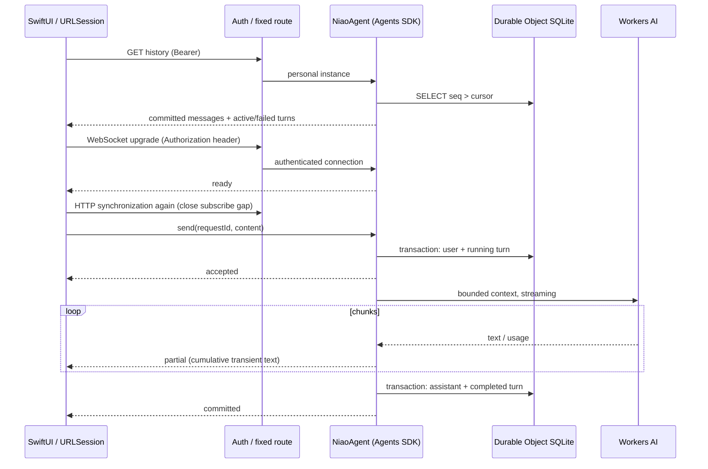

# Phase 1 architecture

## Flow and ownership

The Worker authenticates every application endpoint before Agent routing. Only the `NiaoAgent` class and `personal` instance are reachable. There is no public arbitrary-instance factory. Health means the Worker is configured and reachable; it does not consume an inference or attest AI availability.

The SDK supplies Durable Object routing/identity, lifecycle, hibernatable WebSocket connections, connection iteration, and parameterized SQLite access. Cloudflare supplies storage durability and the AI binding. Application code owns append-only messages, monotonic cursors, idempotent turn IDs, concurrency, context budgets, error classification, and client reconciliation. No SDK state synchronization, tools, schedules, or RPC methods are exposed by this app. Connections are marked read-only for SDK state writes, and SDK protocol broadcasts are disabled; application WebSocket messages remain enabled.

## Protocol decision, inspected 2026-10-27

Inspected official documentation and the published source of **agents 0.31.0** and **@cloudflare/ai-chat 0.12.2**, including `AIChatAgent`, `WebSocketChatTransport`, and message types:

- [Official chat-agent API](https://developers.cloudflare.com/agents/communication-channels/chat/chat-agents/)
- [AIChatAgent source](https://github.com/cloudflare/agents/tree/main/packages/ai-chat/src)
- [Official Agents source](https://github.com/cloudflare/agents/tree/main/packages/agents/src)
- [HTTP and WebSockets](https://developers.cloudflare.com/agents/communication-channels/http-and-websockets/)
- [GLM-4.7-Flash input/output](https://developers.cloudflare.com/workers-ai/models/glm-4.7-flash/)

The official JSON-over-WebSocket format is technically implementable in Swift. It envelopes AI SDK UI-message stream chunks, provides stream replay, and includes cancellation, tool continuation, and mutable message-list synchronization. The published transport's `sendMessages` serializes the client's message array; `AIChatAgent` transforms it, broadcasts it, and persists it with stale-row deletion. Its hooks and request-origin IDs do not by themselves provide this application's append-only, cursor-based, idempotent submission contract.

For this small native client, porting the UIMessage transport/replay reducer and adding separate immutable submission/cursor tracking would introduce two synchronization models. We instead use base `Agent` and the small versioned [application protocol](protocol.md). This is a deliberate scope decision, not a claim that official clients require React or that the official protocol cannot run natively. No `AIChatAgent` persistence or replay runs in parallel with the custom implementation. Revisit the decision if tools, resumable reasoning, rich message parts, or web clients become requirements.

The npm source files used to verify the decision were `@cloudflare/ai-chat/dist/index.js` (constructor chat-request handler) and `agents/dist/ws-chat-transport-*.js` (`sendMessages`), not only an outdated example using the retired `agents/ai-chat-agent` import.

## Persistence and execution

`niao_messages` contains `seq INTEGER PRIMARY KEY AUTOINCREMENT`, unique `id`, `requestId`, role, content, and UTC creation time. `UNIQUE(requestId, role)` limits one user/assistant pair per turn. `niao_turns` records running, completed, or failed status and a safe error code. User IDs equal the client UUID; assistant IDs are deterministically `assistant:<UUID>`.

The agent claims a single active turn synchronously before any await, then transactionally saves the user and running state. A duplicate completed submission returns the existing pair; an in-flight duplicate returns acceptance and a transient snapshot. The same ID with different normalized content is rejected. A different concurrent request is rejected as busy without persisting it. Provider failures leave the user saved and turn retryable. Retrying reuses the user row and invokes only the missing assistant turn. Exactly-once provider billing is not promised across a crash between inference and commit, but duplicate persisted messages are prevented.

Streaming text is provisional, held in memory and shown separately. Only a successfully terminated, nonempty provider stream creates an assistant message. A dropped/truncated provider stream is an error. On a new isolate, any running row is marked interrupted; explicit user retry avoids an invisible paid re-generation. No background task or alarm is used. Hibernation during idle retains history; active WebSocket event work awaits generation. HTTP reconciliation also detects interrupted turns for sockets that survived hibernation without a new connect event.

Context includes only completed messages preceding the submitted user plus that user (also on historical retries), bounded to 24 messages and 24,000 UTF-16 code units, with a system instruction added. This is a conservative content budget, not an exact token counter. Input is capped at 8,000 code units; output is capped at 2,048 model tokens and 64,000 code units. Generation has a 90-second hard deadline, including provider setup, and cancellation is best-effort. GLM thinking is disabled through its provider-specific configuration. Safe numeric token/Neurons fields are recorded when returned.

## Client synchronization

URLSession performs authenticated HTTP and WebSocket requests without browser cookies or query-string credentials. Startup reconstructs history from cursor zero in pages of 100. Reconnect fetches since the last HTTP cursor, subscribes, then fetches again before sending. A WebSocket event never advances the HTTP cursor: a later broadcast cannot hide an earlier missing message. ID-based merging handles overlap and retries.

The socket queues events while HTTP sync is in progress. The app renders user and final assistant rows from server messages; partial snapshots never enter that array. Every 20 seconds a WebSocket ping with a 10-second deadline checks socket liveness, followed by HTTP reconciliation for missed events and interrupted status. An HTTP response cannot roll back turn/partial state when a newer socket event arrived while it was in flight. On failure the socket closes and reconnects with exponential backoff capped at 30 seconds plus jitter. Sleep cancels the connection; wake starts a new connection. Authentication/configuration failures stop retries until configuration or manual reconnect.

A single unacknowledged submission is written atomically to a mode-0600 file before network send. It remains bound to its backend URL. Once the server's user row is observed, the server owns recovery and the local outbox is removed. A crash before acknowledgment therefore reuses the same ID. Failed server turns have explicit Retry buttons. Discarding an uncertain local outbox does not delete a message that may already be on the server; the next sync still retrieves it.

## Authentication and logs

Use a random 32-byte token, shared by this one user and the Worker. Server secret is Wrangler `NIAO_TOKEN`; client storage is a generic password Keychain item keyed by backend URL. The Worker compares SHA-256 digests using timing-safe equality. Missing/short server secrets fail closed. Authentication occurs before both HTTP routing and WebSocket upgrades. HTTPS/WSS is required outside loopback and redirects are rejected.

Structured logs contain event names, random request/connection IDs, model identifier, duration, numeric usage, and safe error codes. The code does not serialize exceptions returned by a model provider, request headers, or message contents. SDK observability emission is disabled to keep the logged field set explicit. Worker observability storage is disabled by default; `wrangler tail` can inspect structured console events when needed. Remote AI infrastructure still processes the submitted context normally.

Token rotation requires updating Keychain too. Existing authenticated sockets are not immediately revoked by changing the secret; close them or restart/deploy the Worker when immediate revocation is required. This is a personal, single-user trust boundary, not a multi-tenant authorization system.

## Daily usage (2026-10-28)

`UsageAnalytics` reads `aiInferenceAdaptiveGroups.sum.totalNeurons` through Cloudflare's official GraphQL API using server-only `CF_ACCOUNT_ID` / `CF_ANALYTICS_TOKEN`. Scope is the entire account and UTC day, not a single model. Failures are distinct from zero; remote results have a 60-second success cache and 15-second failure cache. The native UI fetches independently of chat so Analytics failure does not disconnect conversation.

The existing SQLite Agent also records inference attempts and provider-reported neurons. Replayed completed submissions create no attempt; retries that actually invoke the provider do. Unknown usage remains null and is counted separately. This observation ledger is a clearly labelled fallback, not a reconstruction of full account billing. No model rates or tokens-to-neurons guesses are used. Configuration and limitations are in [usage.md](usage.md).
