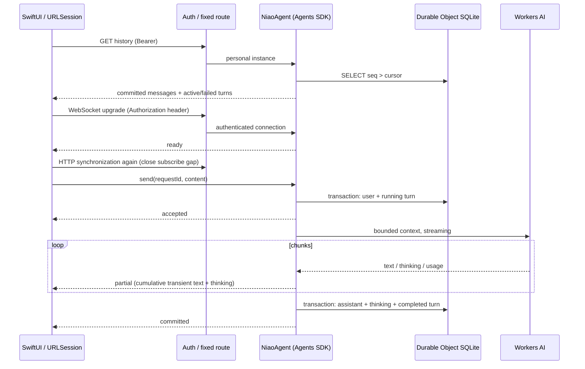

# Phase 1 architecture

## Flow and ownership

The Worker authenticates every application endpoint before Agent routing. Only the `NiaoAgent` class and `personal` instance are reachable. There is no public arbitrary-instance factory. Health means the Worker is configured and reachable; it does not consume an inference or attest AI availability.

The SDK supplies Durable Object routing/identity, lifecycle, hibernatable WebSocket connections, connection iteration, and parameterized SQLite access. Cloudflare supplies storage durability and the AI binding. Application code owns messages (append-only between explicit cleanups), monotonic cursors, idempotent turn IDs, concurrency, context budgets, error classification, and client reconciliation. No SDK state synchronization, tools, schedules, or RPC methods are exposed by this app. Connections are marked read-only for SDK state writes, and SDK protocol broadcasts are disabled; application WebSocket messages remain enabled.

## Protocol decision, inspected 2026-10-27

Inspected official documentation and the published source of **agents 0.31.0** and **@cloudflare/ai-chat 0.12.2**, including `AIChatAgent`, `WebSocketChatTransport`, and message types:

- [Official chat-agent API](https://developers.cloudflare.com/agents/communication-channels/chat/chat-agents/)
- [AIChatAgent source](https://github.com/cloudflare/agents/tree/main/packages/ai-chat/src)
- [Official Agents source](https://github.com/cloudflare/agents/tree/main/packages/agents/src)
- [HTTP and WebSockets](https://developers.cloudflare.com/agents/communication-channels/http-and-websockets/)
- [GLM-4.7-Flash input/output](https://developers.cloudflare.com/workers-ai/models/glm-4.7-flash/)

The official JSON-over-WebSocket format is technically implementable in Swift. It envelopes AI SDK UI-message stream chunks, provides stream replay, and includes cancellation, tool continuation, and mutable message-list synchronization. The published transport's `sendMessages` serializes the client's message array; `AIChatAgent` transforms it, broadcasts it, and persists it with stale-row deletion. Its hooks and request-origin IDs do not by themselves provide this application's append-only, cursor-based, idempotent submission contract.

For this small native client, porting the UIMessage transport/replay reducer and adding separate immutable submission/cursor tracking would introduce two synchronization models. We instead use base `Agent` and the small versioned [application protocol](protocol.md). This is a deliberate scope decision, not a claim that official clients require React or that the official protocol cannot run natively. No `AIChatAgent` persistence or replay runs in parallel with the custom implementation. Revisit the decision if tools, resumable reasoning, rich message parts, or web clients become requirements.

The npm source files used to verify the decision were `@cloudflare/ai-chat/dist/index.js` (constructor chat-request handler) and `agents/dist/ws-chat-transport-*.js` (`sendMessages`), not only an outdated example using the retired `agents/ai-chat-agent` import.

## Persistence and execution

`niao_messages` contains `seq INTEGER PRIMARY KEY AUTOINCREMENT`, unique `id`, `requestId`, role, content, and UTC creation time. `UNIQUE(requestId, role)` limits one user/assistant pair per turn. `niao_turns` records running, completed, or failed status and a safe error code. User IDs equal the client UUID; assistant IDs are deterministically `assistant:<UUID>`.

The agent claims a single active turn synchronously before any await, then transactionally saves the user and running state. A duplicate completed submission returns the existing pair; an in-flight duplicate returns acceptance and a transient snapshot. The same ID with different normalized content is rejected. A different concurrent request is rejected as busy without persisting it. Provider failures leave the user saved and turn retryable. Retrying reuses the user row and invokes only the missing assistant turn. Exactly-once provider billing is not promised across a crash between inference and commit, but duplicate persisted messages are prevented.

Streaming text is provisional, held in memory and shown separately. Only a successfully terminated, nonempty provider stream creates an assistant message. A dropped/truncated provider stream is an error. On a new isolate, any running row is marked interrupted; explicit user retry avoids an invisible paid re-generation. No background task or alarm is used. Hibernation during idle retains history; active WebSocket event work awaits generation. HTTP reconciliation also detects interrupted turns for sockets that survived hibernation without a new connect event.

Context includes only completed messages preceding the submitted user plus that user (also on historical retries), bounded to 24 messages and 24,000 UTF-16 code units, with a system instruction added. This is a conservative content budget, not an exact token counter. Input is capped at 8,000 code units; output is capped at 2,048 model tokens and 64,000 code units. Generation has a 90-second hard deadline, including provider setup, and cancellation is best-effort. GLM thinking is disabled through its provider-specific configuration. Safe numeric token/Neurons fields are recorded when returned.

## Client synchronization

URLSession performs authenticated HTTP and WebSocket requests without browser cookies or query-string credentials. Startup reconstructs history from cursor zero in pages of 100. Reconnect fetches since the last HTTP cursor, subscribes, then fetches again before sending. A WebSocket event never advances the HTTP cursor: a later broadcast cannot hide an earlier missing message. ID-based merging handles overlap and retries.

The socket queues events while HTTP sync is in progress. The app renders user and final assistant rows from server messages; partial snapshots never enter that array. Every 20 seconds a WebSocket ping with a 10-second deadline checks socket liveness, followed by HTTP reconciliation for missed events and interrupted status. An HTTP response cannot roll back turn/partial state when a newer socket event arrived while it was in flight. On failure the socket closes and reconnects with exponential backoff capped at 30 seconds plus jitter. Sleep cancels the connection; wake starts a new connection. Authentication/configuration failures stop retries until configuration or manual reconnect.

A single unacknowledged submission is written atomically to a mode-0600 file before network send. It remains bound to its backend URL. Once the server's user row is observed, the server owns recovery and the local outbox is removed. A crash before acknowledgment therefore reuses the same ID. Failed server turns have explicit Retry buttons. Discarding an uncertain local outbox does not delete a message that may already be on the server; the next sync still retrieves it.

## Authentication and logs

Use a random 32-byte token, shared by this one user and the Worker. Server secret is Wrangler `NIAO_TOKEN`; client storage is a generic password Keychain item keyed by backend URL. The Worker compares SHA-256 digests using timing-safe equality. Missing/short server secrets fail closed. Authentication occurs before both HTTP routing and WebSocket upgrades. HTTPS/WSS is required outside loopback and redirects are rejected.

Structured logs contain event names, random request/connection IDs, model identifier, duration, numeric usage, and safe error codes. The code does not serialize exceptions returned by a model provider, request headers, or message contents. SDK observability emission is disabled to keep the logged field set explicit. Worker observability storage is disabled by default; `wrangler tail` can inspect structured console events when needed. Remote AI infrastructure still processes the submitted context normally.

Both native clients use the Data Protection Keychain with device-only, when-unlocked accessibility. The macOS target uses development signing and a private keychain access group. Legacy macOS credentials are copied only when the destination item is absent, verified by reading back, and retained in the old store. Migration errors never bypass the destination store. Owner authentication remains an app-level gate, rather than a biometric item ACL. See [Keychain details](keychain-auth.md).

Token rotation requires updating Keychain too. Existing authenticated sockets are not immediately revoked by changing the secret; close them or restart/deploy the Worker when immediate revocation is required. This is a personal, single-user trust boundary, not a multi-tenant authorization system.

## Daily usage (2026-10-28)

`UsageAnalytics` reads `aiInferenceAdaptiveGroups.sum.totalNeurons` through Cloudflare's official GraphQL API using server-only `CF_ACCOUNT_ID` / `CF_ANALYTICS_TOKEN`. Scope is the entire account and UTC day, not a single model. Failures are distinct from zero; remote results have a 60-second success cache and 15-second failure cache. The native UI fetches independently of chat so Analytics failure does not disconnect conversation.

The existing SQLite Agent also records inference attempts and provider-reported neurons. Replayed completed submissions create no attempt; retries that actually invoke the provider do. Unknown usage remains null and is counted separately. The Clef judge additionally uses its reported input tokens and the official rate when neurons are absent; rate-derived entries are labelled and retain their conversion basis. This ledger is a fallback, not a reconstruction of full account billing. Configuration and limitations are in [usage.md](usage.md).

`GET /agents/niao-agent/personal/platform-usage` is a separate authenticated, read-only endpoint for UTC-day account-wide Workers requests (`workersInvocationsAdaptive.sum.requests`) and Durable Objects duration (`durableObjectsPeriodicGroups.sum.duration`, already GB-s). `PlatformAnalytics` requests these independently so one unavailable dataset cannot hide the other. The macOS Workers statistics tab fetches on opening/manual refresh; this adds no background chat polling. `readCloudflare` shares bounded, redacted diagnostics and redirect-safe HTTP handling with Neurons analytics. Each daily metric has a 60-second cache, a 15-second failure cache, concurrent-request deduplication and UTC rollover invalidation.

Plan verification reads account subscriptions, requiring `Billing Read` in addition to `Account Analytics Read`. Only Workers subscriptions affect the verdict; zone Free/Pro subscriptions do not. Paid includes an active known Workers paid subscription or a cancelled subscription whose paid period has not ended. Free is inferred from the complete successful list having no active Workers paid subscription. Unknown subscription types, incomplete pagination, API/permission failures remain unverified. Subscription retrieval is bounded to ten pages and eight seconds total; successful plan checks are cached for one hour. No billing details or Cloudflare tokens reach the app. Free comparison bars are always labelled as a reference, including when the plan is Paid or unverified. No new storage tables, secrets or bindings are required.

## Model settings and history cleanup (2026-10-28)

`niao_settings` persists the selected model, `thinkingMode` (`auto/on/off`), adjustable `thinkingPolicy`, and a conversation epoch. The model catalog advertises `supportsThinking`. Model/mode/policy are snapshotted at turn start, including tool continuations. Updating settings never invokes the model. Thinking applies only to Gemma; GLM skips both thinking and judging while retaining the saved mode. Idempotent column migrations preserve legacy ON/OFF and model/epoch/history; new settings default to OFF. Older model-only API updates preserve auto, and explicit legacy boolean updates select manual ON/OFF.

Cleanup is an application transaction, not deletion of the Durable Object: it deletes messages and turn identities, increments the epoch, and preserves settings and usage. It is refused during inference. The epoch serves both as a DELETE precondition and a fence for offline submissions and stale HTTP/socket delivery; a monotonic message cursor alone cannot invalidate a client's cached deleted rows. The Swift client resets local history and drops an older outbox when the epoch advances. The SQL sequence is deliberately not reset.

## Isolated Ruby tool

The Agent still owns durable conversations. `WorkersAIModel` assembles official streaming function-call deltas and performs at most three `ruby_eval` calls, with up to four inference requests. Every inference request receives its own usage-attempt row. Tool traces are ephemeral; only user/final assistant messages persist. An interrupted turn requires explicit retry.

The evaluator uses a Niao-owned C extension with PicoRuby's mruby backend and compiler, now hosted by the **statically deployed** `niao-ruby-runner`. The Agent uses a typed `Service<RubyRunner>` binding and calls `execute({code})`. Only the immutable compiled Wasm module is reused; instance memory, compiler state and VM state are recreated for each call. Runner RPC adds stdout/stderr/exitCode and timing metadata; the application adapter preserves the previous model-facing result shape and `ruby_eval` tool name.

The Runner has no resource bindings or secrets, disables workers.dev/preview URLs, and rejects HTTP requests. It exposes no networking/filesystem/ENV imports to Ruby. A per-isolate busy flag limits overlapping VM allocations. The instruction hook, source/output caps, and fixed 32MiB linear memory remain. References are dropped after each request; memory reclamation is GC-driven, not immediate.

This removes the paid-only Dynamic Workers dependency, but also removes its outbound-network policy and per-invocation CPU limit. Service Binding separation is not an equivalent untrusted-code security boundary: the standard Worker host still has network APIs, and callers/callees may share a thread. Bytecode fuel does not meter native C/compiler work, and AbortSignal cannot preempt it. Only platform CPU enforcement covers those paths. Local Node CPU measurements suggest lightweight workloads are candidates for Free, but first execution approaches 10ms; hosted Free behavior is unverified without deployment. See [ruby-tool.md](ruby-tool.md).

## Gemma thinking output (2026-10-29)

`ModelOutputAdapter` normalizes text without owning tools, persistence, or orchestration. `DefaultAdapter` passes content through exactly. `Gemma4Adapter` recognizes Google's documented `<|channel>thought\n...<channel|>answer` format using a streaming state machine. It retains only a possible delimiter prefix or a bounded channel header, so final content does not wait for the whole generation. Unknown channel headers are treated as thinking; incomplete delimiter prefixes are withheld at EOF. A plain word such as `thought` without a delimiter is ordinary text, rather than a heuristic signal to delete text.

References inspected: [Google's Gemma 4 prompt format](https://ai.google.dev/gemma/docs/core/prompt-formatting-gemma4), [official chat template](https://huggingface.co/google/gemma-4-26B-A4B-it/raw/main/chat_template.jinja), and [Cloudflare's Gemma model schema](https://developers.cloudflare.com/workers-ai/models/gemma-4-26b-a4b-it/). Local requests using the real remote AI binding also confirmed `choices[0].delta.reasoning_content` alongside `delta.content`. For Gemma only, structured `reasoning_content` (or `reasoning`) is routed to thinking and normalized for stray channel delimiters. Other models keep their existing content behavior. The settings UI/API now controls `chat_template_kwargs.enable_thinking` for Gemma, initially OFF. The model catalog and 2,048-token output budget are unchanged. Returned thinking is normalized even when the option is OFF; the option requests generation behavior, not suppression of returned data.

Every model invocation, including each tool continuation, gets fresh adapters. Thinking events carry a zero-based `generation` index within the turn. Text normalization never receives structured function arguments/results. Only normalized assistant content is sent in the next tool-continuation request, and future-turn context queries select only `niao_messages.content`.

The optional `thinking` array accompanies cumulative partial/active snapshots and committed assistant messages. Each segment has `generation`, `text`, and `active`. Thinking is bounded to 32,000 UTF-16 code units across a turn, independently of the existing 64,000-unit answer limit. Successful completion saves nonblank thinking in `niao_thinking(requestId,generation,text)` in the same transaction as the assistant message and completed turn. Restored segments are inactive. `CREATE TABLE IF NOT EXISTS` adds the table on activation without rewriting existing history or requiring a Durable Object class migration. History deletion removes these rows too.

Thinking is displayed above the answer in a native, initially collapsed 「思考過程」 disclosure. Expanded text is subdued and preserves whitespace; tool continuations are labelled by generation. Active thinking shows an in-progress indicator. Thinking remains accessible after reconnect/app or Agent restart for completed turns. Failed/interrupted generations keep the existing transient-output policy: neither partial answer nor partial thinking is committed. A thinking-only response is an `empty_ai_response`, never an implicit final answer. Legacy stored raw responses are not retrospectively reinterpreted because they have no trustworthy model/format metadata. Thinking is private conversation data and is never included in logs.

## Automatic thinking policy (2026-10-29)

`ClefThinkingJudge` is a small nonstreaming provider adapter in `thinking-policy.ts`, independent of chat generation and Ruby tools. In auto mode on a supported model, the Agent records a judge attempt, calls Clef-flash once with bounded recent ordinary conversation, then freezes the resulting boolean for every inference in the turn. The configured low/high thresholds delimit a tunable uncertainty band. Ambiguity defaults to ON; malformed output, request errors and a bounded timeout always fall back to ON. The global 90-second turn deadline also covers judging, and parent cancellation prevents a late judge from starting a new model inference. Manual modes and unsupported models skip the judge. No extra Worker, binding, SDK runtime or model fallback is introduced.

Judge entries share `niao_usage_attempts` with model inferences, so totals include both without a second additive aggregation. `niao_judge_attempts` adds only metadata: duration, score, reason, usage source, input tokens and conversion rate. These records survive history cleanup, just like inference usage. Clef currently returns tokens without neurons; use provider neurons if present, otherwise calculate from the official model rate and label the result as rate-derived. Unavailable usage remains unknown. The account-wide GraphQL result is never increased by local values. Wait time is recorded separately in milliseconds, not converted into neurons. See [policy, API, measurements and limits](automatic-thinking.md).

## Past Logs archive (2026-10-29)

`apps/past-logs` is an independent stateless Worker with D1. Authenticated REST manages source documents; a separate read credential exposes `search_past_logs`, `search_past_logs_semantic` and `get_past_log` through `createMcpHandler()` (Agents 0.31.0, MCP SDK v2). Both entry points use `DocumentService`. Stable source identities and SQLite triggers keep idempotent imports and the FTS index consistent. Original publication/modification dates remain separate from import timestamps.

Japanese CJK bigrams/unigrams and normalized English words are encoded into a standard FTS5 index. Phrase matching preserves contiguous Japanese matches; multiword queries use AND, with weighted BM25 ranking. Neither LIKE scans nor embeddings are the search strategy. The original text and citation URLs remain intact.

Niao uses its built-in MCP manager for Streamable HTTP discovery and calls. An application adapter converts `getAITools()` schemas to Workers AI function definitions, and uses the manager's cancellable `callTool()` API. The existing bounded tool loop, Ruby execution, conversation persistence and client protocol remain in place. Only the three archive tool names are accepted. HTTP setup/call failures degrade to chat or safe tool errors. Bearer headers are injected by an in-memory fetch function, never serialized into SDK connection rows; per-turn cleanup also prevents stale catalogs after secret changes.

No new Durable Object is required. Source documents are untrusted reference data, not conversation instructions. Authentication, normalization/index policy, source identity, output bounds and citation guidance are application responsibilities; MCP wire protocol, schema discovery and client transport are SDK responsibilities. See [Past Logs setup, search limitations and deployment](past-logs.md).

## Semantic Past Logs retrieval

The same archive now also exposes `search_past_logs_semantic`. Niao chooses between literal keyword retrieval and semantic retrieval, or compares both; it uses the shared `get_past_log` for original documents. The Agent still owns response generation and its bounded tool loop. No RAG orchestration framework or additional answer-generating model is introduced.

D1 remains canonical. Qwen3-Embedding-0.6B (1024 dimensions) embeds overlapping Unicode chunks into Vectorize. SQL triggers atomically queue desired index revisions with each source mutation. Per-document leases, stable revision-specific vector IDs and persisted batch progress let an explicit administrative reindex command recover interrupted/failed indexing. Vectorize acknowledgement is labelled `submitted`, since visibility is eventual. Search hydrates only chunks matching the current D1 revision, excluding stale or deleted source text even while vector mutations are delayed. Retired chunk IDs/tombstones remain available for reconciliation; physical vector cleanup is not an atomic cross-store guarantee.

Development uses a separate remote Vectorize index with local Worker/D1. Offline development keeps real local keyword search and returns explicit semantic-unavailable errors. Only automated tests inject deterministic AI/vector fixtures. See [semantic setup, consistency and limitations](past-logs-semantic.md).

Past LogsのCosense同期は、AgentやMCPセッションから独立したscheduled/queueハンドラーで行います。D1の発見候補をoutboxとして保持し、Queueは少なくとも1回の配送として扱います。既存DocumentServiceとSemanticIndexを使い、文書ID・FTS・意味索引の責任をスケジューラーに複製しません。設定・再開・運用は[Cosense自動同期](cosense-sync.md)を参照してください。

## Miscellaneous tools

`niao-tools-misc` is a static, independently deployed Worker for small network tools. NiaoAgent registers thin `AdditionalTool` adapters backed by `TOOLS_MISC` Service Binding RPC. Open-Meteo location/forecast HTTP calls, bounded response parsing and WMO descriptions belong to the service; shared input contracts belong to `apps/tools-misc/src/contracts.ts`. Location resolution and forecast retrieval are separate tool calls so ambiguous places can be clarified. The existing server-side loop, three-call budget, status notifications and client statistics apply unchanged. Only the relevant archive/weather system guidance is included for advertised tools. The service has no secrets or storage bindings and no public HTTP API. See [weather-tools.md](weather-tools.md).

Kani reading tools also live behind `TOOLS_MISC`: canonical article Markdown, RSS latest-publication selection, and deterministic title substring search from the Markdown index. Latest retrieval delegates to the same bounded article reader, so metadata and content handling are shared. Article summarization and the short personal impression belong to the Agent's existing model loop, not a second model in the service. Fixed-host requests, Markdown negotiation, XML declaration rejection, Unicode pagination, untrusted-data guidance and safe errors apply. See [kani-tools.md](kani-tools.md).

## Qwen 3.8 model integration

The catalog includes `@cf/qwen/qwen3.8-27b` with `supportsThinking=true`. `modelThinkingOptions()` maps the existing per-turn boolean to explicit enable_thinking plus low effort when ON, and no effort parameter when OFF. The Clef decision and auto-frequency thresholds are unchanged. Only Qwen 3.8 ON raises the completion cap to 8192. Structured reasoning and inline think tags are separated using the same ModelEvent/Swift disclosure/persistence path as Gemma. Stored reasoning is not replayed to the provider. Existing models retain their parameters, default model and message protocol. See [automatic-thinking.md](automatic-thinking.md).

## iPhoneクライアント

`apps/ios/Niao.xcodeproj`はmacOS版のSwiftソースを共有してビルドします。Agent loopや通信プロトコルはサーバー側のままです。iOSでは統計をシート表示し、バックグラウンド移行で接続と認証セッションを閉じ、復帰後に既存のHTTP/WS同期を再利用します。実機署名やFace IDを含む手順は[iOS版](ios.md)を参照してください。

## Web Fetch

`web_fetch_async`はAgentのSQLite outboxからCloudflare Queuesへ投入し、既存Agent Workerのconsumerがtools-miscを呼びます。結果は内部RPCでAgentへ永続化してからackし、通常ターンと共通の実行ゲートが空いたところでツールなし・Thinking OFFの要約を生成します。通知本文とジョブ完了は同一トランザクションで保存し、`message_added`で配信します。SDKの永続スケジュールが投入失敗・lease切れ・通知失敗を回復し、epochで履歴削除後の結果を除外します。詳細は[非同期Web Fetch](async-fetch.md)。

`web_fetch`はtools-miscのRPCとして公開します。AgentはURLだけを送り、Tools Workerが公開URL/DNSの検証、手動redirect、本文のストリーム上限、Readability / LinkeDOM / Turndownによる抽出と出力制限を担当します。DOMを再パースせず、抽出結果を参照データとしてLLMへ返します。認証情報を外部へ渡さず、ツールWorkerにも追加の秘密やstorage bindingを持たせません。DNSの事前検査にはIP固定の保証がないため、その限界とCPUのローカル計測を[Web Fetch](web-fetch.md)に明記しています。同期版はBrowser Runを呼びません。非同期版は専用の`TOOLS_MISC.webFetchAsync()`で取得・検証後のHTMLを`BROWSER.quickAction("markdown", {html})`へ渡し、DOM構築とMarkdown変換をBrowser Runへ移します。能動要素の除去・先頭CSP・ブラウザーのネットワーク拒否を併用し、最終URLとジョブ形式を維持します。Browser bindingはtools-miscだけが持ちます。詳細は[非同期Web Fetch](async-fetch.md)。

`set_reminder`は分数と通知内容を受け取り、AgentのSQLiteに保存してSDKの永続スケジュールで通知します。期限とその1分後に起動を予約し、返信中は完了を待って配信します。履歴保存と通知済み状態の更新は同一トランザクションで行い、`message_added`で配信します。履歴削除時には未通知のリマインダーも削除します。1〜43200分、未通知20件まで。通知は履歴に残り、OSプッシュは行いません。実際の配信は実行状況によって遅れる場合があります。

## Llama / Granite model integration

The model catalog also includes `@cf/meta/llama-3.3-70b-instruct-fp8-fast`, `@cf/meta/llama-4-scout-17b-16e-instruct` and `@cf/ibm-granite/granite-4.0-h-micro`. All three reuse the existing SSE parsing, bounded tool loop, SQLite history and usage ledger. They advertise `supportsThinking:false`, skip the judge, and use their documented `max_tokens` option without Gemma/Qwen-specific template settings. Only provider-specific request parameters differ; no second tool runtime or client-side model list is introduced. The default model remains Gemma. See [model settings](chat-controls.md).

Qwen3 30B A3B FP8 (`@cf/qwen/qwen3-30b-a3b-fp8`) uses the same Qwen output adapter and tool loop. Its separate request policy uses `max_tokens` (2048 OFF / 4096 ON) and Qwen's per-turn `/think` or `/no_think` soft directive on a copy of the latest user message. It does not assume the Qwen 3.8 reasoning-effort/template API is available. The directive is not persisted and does not change during tool continuations. Soft switching is best-effort; observed reasoning is always separated. See [Thinking and pricing](automatic-thinking.md#qwen3-30b-a3b-fp8).

## 複数の会話 (2026-11-02)

`personal` AgentのSQLite内に会話を分け、モデル設定・利用量・推論ゲートは共通化する。会話の寿命は `lastActivityAt`、メタデータの更新は `updatedAt` で管理する。保持期限30日と明示削除の両方を持つ。WebSocketはv2で多重化し、HTTPで会話ごとの履歴を復元する。非同期結果は画面選択と独立して依頼元へ戻す。[保存・移行・API・制限](sessions.md)を参照。
